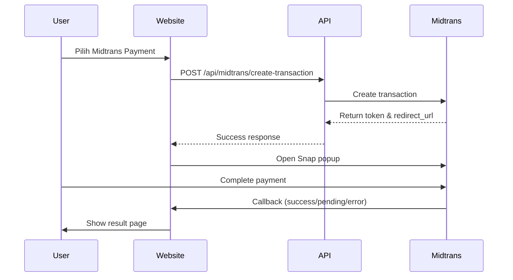

# Midtrans Payment Integration Guide

## Overview
Website Habema Outdoor telah diintegrasikan dengan Midtrans Payment Gateway untuk mendukung berbagai metode pembayaran digital di Indonesia.

## 🚀 Setup Instructions

### 1. Daftar Akun Midtrans
1. Kunjungi [Midtrans Dashboard](https://dashboard.midtrans.com/)
2. Register akun baru atau login ke akun existing
3. Pilih tipe akun "Sandbox" untuk development

### 2. Dapatkan Kredensial API
1. Di dashboard Midtrans, buka menu **Settings → Access Keys**
2. Copy **Server Key** dan **Client Key**
3. Untuk development, gunakan kredensial Sandbox

### 3. Environment Variables
Buat file `.env.local` di root project:

```bash
# Midtrans Configuration
NEXT_PUBLIC_MIDTRANS_CLIENT_KEY=your_client_key_here
MIDTRANS_SERVER_KEY=your_server_key_here
MIDTRANS_PRODUCTION=false

# Base URL (optional, default localhost:3000)
NEXT_PUBLIC_BASE_URL=https://your-domain.com
```

### 4. Install Dependencies
```bash
npm install midtrans-client @types/midtrans-client
```

## 💳 Metode Pembayaran yang Didukung

### Midtrans Snap
- **Kartu Kredit**: Visa, Mastercard, JCB
- **E-Wallet**: GoPay, ShopeePay, OVO, Dana
- **Virtual Account**: BCA, Mandiri, BNI, BRI, Permata
- **Bank Transfer**: BCA KlikPay, BCA KlikBCA, BRI E-Pay
- **Cicilan**: Kartu kredit cicilan 3, 6, 12 bulan

### Transfer Bank Manual
- BCA, Mandiri, BNI, BRI
- Konfirmasi manual via WhatsApp

## 🔄 Payment Flow

### 1. User memilih produk
- Browse catalog → Add to cart
- Pilih tanggal sewa
- Review order summary

### 2. Payment Selection
- Pilih "Midtrans Payment" atau "Transfer Bank"
- Input customer data (untuk Midtrans)

### 3. Midtrans Flow


### 4. Status Handling
- **Success**: Redirect ke `/checkout`
- **Pending**: Redirect ke `/payment/pending`
- **Error**: Redirect ke `/payment/error`

## 📁 File Structure

```
/app
  /api/midtrans
    create-transaction/route.ts    # API endpoint
  /payment
    page.tsx                      # Payment method selection
    pending/page.tsx              # Pending payment page
    error/page.tsx                # Error payment page
    finish/page.tsx               # Success callback page

/lib
  midtrans.ts                    # Midtrans utilities & types

.env.local.example               # Environment variables template
```

## 🔧 Configuration Options

### Environment Variables
- `NEXT_PUBLIC_MIDTRANS_CLIENT_KEY`: Client key untuk frontend
- `MIDTRANS_SERVER_KEY`: Server key untuk backend API
- `MIDTRANS_PRODUCTION`: Set `true` untuk production mode
- `NEXT_PUBLIC_BASE_URL`: Base URL untuk callbacks

### Payment Methods Customization
Di `/lib/midtrans.ts`, edit array `enabled_payments`:

```typescript
enabled_payments: [
  'credit_card',      // Kartu kredit
  'gopay',           // GoPay
  'shopeepay',       // ShopeePay
  'bank_transfer',   // Transfer bank
  'echannel',        // Mandiri Virtual Account
  // ... tambahkan metode lain
]
```

## 🧪 Testing

### Sandbox Mode
1. Gunakan kredensial Sandbox
2. Test dengan kartu kredit testing:
   - **Success**: 4811 1111 1111 1114
   - **Challenge**: 4911 1111 1111 1113
   - **Decline**: 4556 7375 8689 9855

### Test Scenarios
```bash
# Test pembayaran sukses
npm run dev
# Buka http://localhost:3000/payment
# Pilih produk → Midtrans Payment
# Gunakan kartu testing success

# Test pembayaran pending
# Gunakan kartu testing challenge

# Test pembayaran error
# Tutup popup payment atau gunakan kartu decline
```

## 🚀 Production Deployment

### 1. Switch to Production
```bash
# Update .env.local
MIDTRANS_PRODUCTION=true
NEXT_PUBLIC_MIDTRANS_CLIENT_KEY=production_client_key
MIDTRANS_SERVER_KEY=production_server_key
```

### 2. Domain Configuration
- Set `NEXT_PUBLIC_BASE_URL` ke production domain
- Update Midtrans dashboard dengan production domain
- Configure SSL certificate

### 3. Security
- Jangan expose server key di frontend
- Gunakan environment variables untuk kredensial
- Implement webhook untuk notifikasi real-time

## 🔍 Troubleshooting

### Common Issues
1. **"Client key not found"**
   - Check `NEXT_PUBLIC_MIDTRANS_CLIENT_KEY` di .env.local
   - Restart development server

2. **"Transaction failed"**
   - Check server key configuration
   - Verify Midtrans account status

3. **"Popup not opening"**
   - Check browser popup blocker
   - Verify Midtrans script loading

### Debug Mode
```typescript
// Enable debug mode di development
console.log('Midtrans Config:', {
  isProduction: process.env.MIDTRANS_PRODUCTION,
  clientKey: process.env.NEXT_PUBLIC_MIDTRANS_CLIENT_KEY?.substring(0, 10) + '...'
})
```

## 📞 Support

### Midtrans Support
- Email: support@midtrans.com
- Phone: (021) 3000 0400
- Documentation: [docs.midtrans.com](https://docs.midtrans.com/)

### Habema Support
- WhatsApp: 0812-3456-7890
- Email: support@habema.com

## 🔄 Next Steps

1. **Webhook Integration**: Implement webhook untuk real-time payment notification
2. **Recurring Payments**: Setup untuk subscription model
3. **Analytics**: Integrate payment analytics
4. **Multi-currency**: Support untuk international payments

---

**Note**: Pastikan untuk mengganti kredensial testing dengan production keys sebelum deploy ke production environment.
